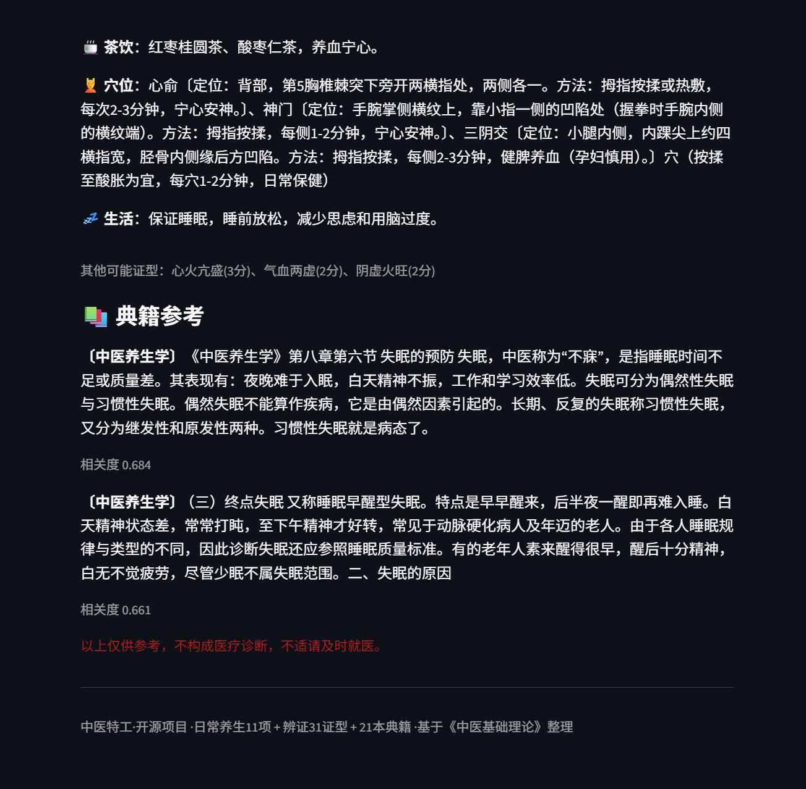
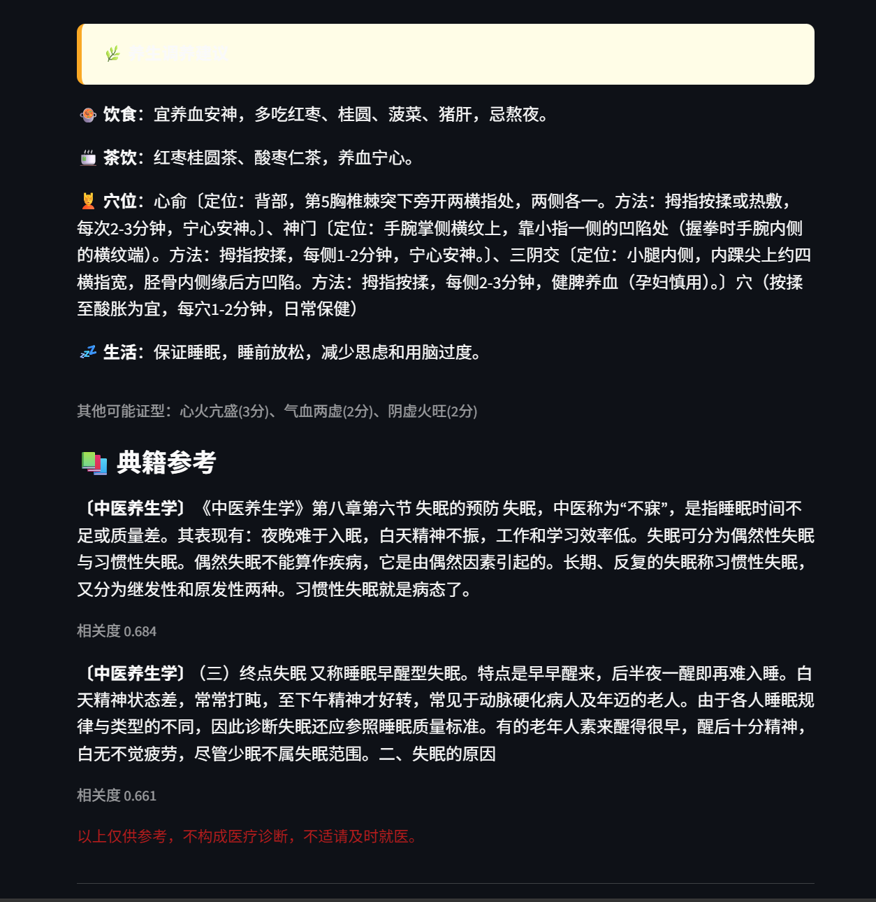
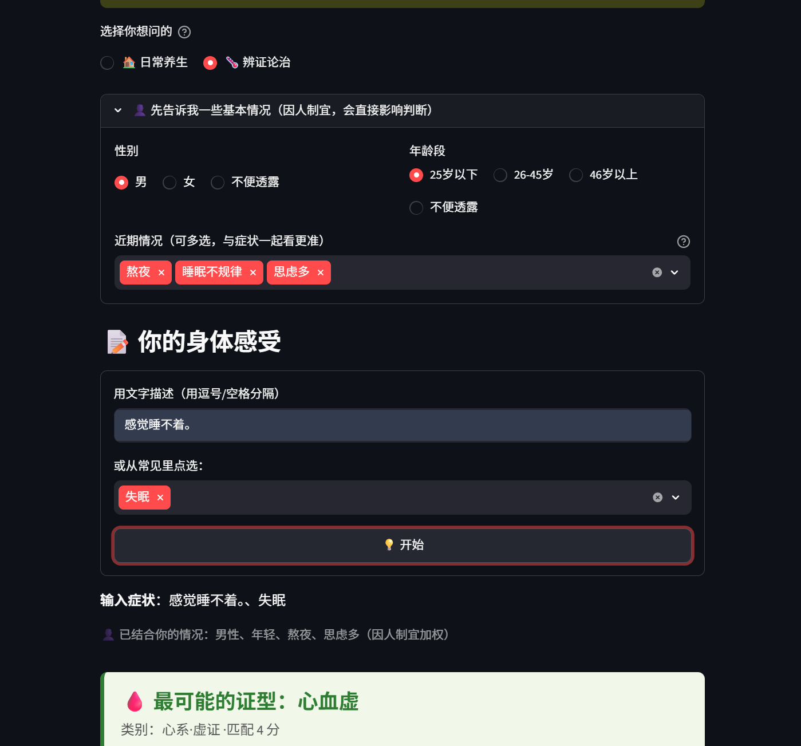

# 🌿 TCM Agent — 中医辨证调养助手

[](https://github.com/leropeter/tcm-agent/actions/workflows/ci.yml)
[](./run_tests.py)
[](./eval/RESULTS.md)
[](./LICENSE)

> 用**人话**描述身体的不舒服，得到：可能的证型 + 为什么这么判 + 今天能做什么（吃什么、按哪、忌什么）。
> 纯本地规则引擎 + 典籍检索，不调用大模型，不需要 API key，离线可用。

**⚠️ 这不是医疗产品。** 仅用于中医知识学习与日常养生参考，不构成诊断，不替代医师。有红旗症状（胸痛、黑便、突发剧烈头痛、单侧肢体无力…）会直接提示就医，不给你开方。

---

## 30 秒跑起来

```bash
pip install streamlit
streamlit run app.py
```

浏览器自动打开 → 输入「吃不下饭，人也没劲，大便稀」→ 开始分析。

Windows 用户也可以直接双击 `启动中医助手.bat`。

**命令行跑一次：**
```bash
python examples/demo.py --symptom "头痛 怕冷 流清涕 无汗"
```

**跑全部测试（276 项，约 40 秒）：**
```bash
python run_tests.py
```

---

## 它到底能到什么程度（真实数字，不美化）

| 维度 | 实测 | 说明 |
|---|---|---|
| 系统测试 | **276 项 / 10 套件 全绿** | `python run_tests.py` 可复现 |
| 口语 Top1 命中 | **72%**（66/92） | `eval/cases_oral.json` 100 条手工标注用例 |
| 过度诊断 | **0 / 8** | 8 条"浑身不得劲"这类笼统输入，无一被硬安证型 |
| 口语回归 | 16/16 | 说"吃不下饭、人也没劲"能判出脾气虚，无需记术语 |
| 真实临床医案（TCMEval-SDT） | 覆盖 48%，证型匹配 **8%** | 见下方「它不能做什么」 |

> 72% 这组数字来自本项目自己的 100 条口语用例，期望值是作者按八纲辨证人工判的，**不是临床金标准**，长期使用会过拟合。换一组外部用例，成绩大概率会更低。`eval/` 里给出了复跑方法，欢迎用你自己的用例打脸。

### 它不能做什么

这一节比上面那张表重要。

- **不是大模型。** 它是 41 个证型的加权规则引擎 + 典籍词频检索。不会推理，只会匹配。所以它认不出的东西，是它真的不会，不是"没发挥好"。
- **复杂真实临床医案上很弱。** 用 TCMEval-SDT 的 200 例真实门诊医案测过（`scripts/evaluate_tcmeval.py`，结果在 `VALIDATION_RESULTS.md`）：能落到某个已知证型的只有 48%，与标准答案完全一致的只有 8%。原因是真实医案的表述远超 41 个证型的词表，这是**方法论瓶颈**，不是调参能解决的。
- **针对的是"普通人的日常不适"**，不是"替代医生看复杂病"。这条路它做得到；上一条它做不到。知道边界在哪，比把准确率吹到 95% 有用。
- **不给剂量。** 61 首方只有药味组成，附子、朱砂这类有毒药和孕妇禁用的方单独标注。理由是：剂量错一点就是事故，而这个项目没有任何能力保证剂量正确。
- 不做舌象/面色图像识别，不做脉诊。

---

## 功能

- **辨证**：41 个证型，覆盖外感、肺、心、肝、脾、肾、气血津液、妇科、儿科
- **说人话就能用**：186+ 条口语映射 + 去助词清洗（"吃不下饭"→"食欲不振"，"蹲下起来发黑"→"头晕"）
- **不硬给结论**：证据不足（只有 1 个线索 / 多个证型分数接近）时，置信度降为「较低」「暂偏向」，并给出针对性追问；完全笼统（"浑身不得劲"）则不给证型，改走分诊追问
- **因人因时**：四季 / 6 类人群 / 14 条诱因 / 20 类伴随症状 / 兼证 / 6 类禁忌，同一证型对不同人不是同一套话
- **参考方剂**：61 首历代代表方，41 证型全覆盖，只给药味不给剂量
- **相似医案**：250 例真实临床医案（TCMEval-SDT），按症状覆盖度检索，附原医师的临证体会
- **典籍原文**：21 本中医经典（8.1MB）切成 14399 块，按书籍性质加权（白话实用类优先，针刺经文降权）；可选语义检索（bge-small-zh）
- **穴位定位**：38 个穴位，每个都有"怎么找到它"+"按揉多久"（不是只丢一个穴名）
- **食疗方**：14 个方，带克数和做法
- **体质**：王琦九种体质识别
- **可解释**：每个结论标注命中了原文里的哪几个词
- **就医红旗**：10 类信号直接提示急诊，排在所有建议之前

### 界面

<p align="center">
  
  
  
</p>

---

## 怎么评的（可复现）

```bash
# 口语评测集：100 条，输出 Top1 命中率 / 过度诊断率
python eval/run_eval.py --md --verbose

# 全套测试：276 项
python run_tests.py

# 口语回归基线
python scripts/regress_slang.py

# 真实临床医案（TCMEval-SDT 200 例）
python scripts/evaluate_tcmeval.py
```

`eval/RESULTS.md` 里是最近一次跑分的完整结果和未通过明细——包括判错的那 26 条，一条没藏。

---

## 项目结构

```
tcm-agent/
├── app.py                 # Streamlit 界面（双模式：日常养生 / 辨证论治）
├── src/
│   ├── agent.py           # 辨证主逻辑 + 置信度三档 assess()
│   ├── knowledge.py       # 41 个证型（症状→权重→依据→建议）
│   ├── normalize.py       # 口语→标准术语归一化（186+ 条）
│   ├── triage.py          # 笼统输入的分诊追问（10 个症状域）
│   ├── probe.py           # 关键词驱动追问（23 词 × 49 问 × 308 选项）
│   ├── advice.py          # 7 维差异化建议引擎
│   ├── formulas.py        # 61 首方剂（只给组成）
│   ├── cases.py           # 250 例医案检索
│   ├── rag.py             # 典籍检索（关键词 + 书籍加权）
│   ├── rag_semantic.py    # 可选语义检索（sentence-transformers）
│   ├── acupoints.py       # 38 穴位定位与按揉法
│   ├── recipes.py         # 14 个食疗方
│   └── constitution.py    # 九种体质
├── eval/                  # 评测集 + 跑分脚本 + 结果
├── tests/                 # 10 个套件 / 276 项
├── scripts/               # 回归、截图、索引构建
├── data/books/            # 21 本典籍（Markdown）
└── docs/                  # 评测与局限说明、本地改动记录
```

## 技术栈

纯 Python + Streamlit。辨证是加权规则打分（`score = Σ 命中的症状权重`），置信度由「分数 + 领先第二名幅度 + 独立症状数」三者共同决定，不是只看分数。

可选语义检索需要 `sentence-transformers` + 预构建索引（`python scripts/build_vector_index.py`）；没建索引时自动降级到关键词检索，不影响启动。

## 致谢与数据来源

- 医案：TCMEval-SDT（Nature 系论文配套数据集，Test 50 / Validation 50 / Train 200）
- 典籍：`wobure/zhongyi-books`（HuggingFace，21 本 / 8.1MB）
- 体质学说：王琦九种体质

## 许可证

MIT。方剂组成与典籍文本来自公有领域古籍，医案来自上述公开数据集，使用时请遵守其原始许可。

## 反馈

开 Issue 就行。特别是：**如果你用它试出来的结果不对，把原话贴进来**——那比任何 star 都值钱，因为口语用例是目前最缺的东西。
